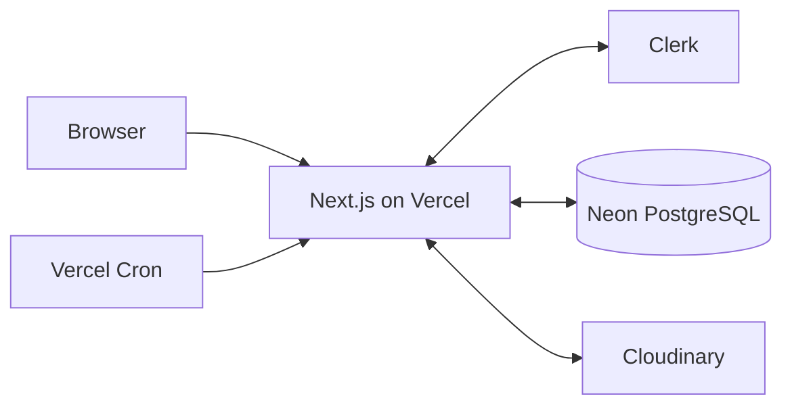

# ClipDrop

**Temporary file and text sharing, with optional clipboard sync across your devices.**

ClipDrop lets you send files, notes, and code snippets through a short share code or link. Shares can expire automatically and can be protected with a password or download limit. Signed-in users also get a dashboard, device management, and cross-device clipboard sync.

[](https://github.com/LuciferAKJ/clipdrop/actions/workflows/ci.yml)
[](https://clipdropshare.vercel.app)

**Live application:** [clipdropshare.vercel.app](https://clipdropshare.vercel.app)

---

## Contents

- [Features](#features)
- [How sharing works](#how-sharing-works)
- [Technology](#technology)
- [Architecture](#architecture)
- [Getting started](#getting-started)
- [Environment variables](#environment-variables)
- [Available scripts](#available-scripts)
- [API overview](#api-overview)
- [Deployment](#deployment)
- [Security and privacy notes](#security-and-privacy-notes)
- [Project documentation](#project-documentation)
- [Contributing](#contributing)

## Features

### Temporary sharing

- Share text, notes, code snippets, and files.
- Generate a short share code and a direct share link.
- Upload files by dragging and dropping, browsing, or pasting supported content.
- Set an automatic expiration period: 1 hour, 6 hours, 12 hours, 1 day, 3 days, 7 days, or 30 days.
- Optionally protect a share with a password.
- Set a download limit or make a share available for one successful download.
- View Markdown and syntax-highlighted code on the receiving page.
- Track upload progress and cancel an upload in progress.

### Signed-in workspace

- View and manage shares from a personal dashboard.
- Register, rename, and remove devices associated with an account.
- Synchronize clipboard text or a share reference between signed-in devices.
- Pause clipboard polling when a browser tab is not visible.

Clipboard synchronization uses a **three-second polling interval** while the tab is visible. When updates conflict, the most recently stored timestamp wins; updates are not merged.

## How sharing works

1. Add text, files, or both to a new share.
2. Choose an expiration period and, if needed, a password or download limit.
3. ClipDrop creates a short code and a shareable link.
4. Send the code or link to the recipient.
5. The recipient opens the share, passes any password prompt, and retrieves the content.

The share endpoint separates metadata lookup from content retrieval: `GET /api/share/[code]` checks the share state, while `POST /api/share/[code]` performs the retrieval and applies download-limit checks. Limited downloads are updated atomically to prevent concurrent requests from exceeding the configured limit.

## Technology

| Area | Technology |
| --- | --- |
| Application | Next.js App Router, React, TypeScript |
| UI | Tailwind CSS, shadcn/ui, Base UI |
| Authentication | Clerk |
| Database | Neon PostgreSQL |
| ORM and database adapter | Prisma, `@prisma/adapter-neon` |
| File storage | Cloudinary |
| Hosting | Vercel |
| Unit and component tests | Vitest, Testing Library |
| Browser tests | Playwright |

## Architecture

ClipDrop uses managed services and serverless request handlers. It does not require a persistent application server or a background worker.



- **Next.js on Vercel** serves the application and API route handlers.
- **Neon PostgreSQL** stores share metadata, file references, users, devices, and clipboard state.
- **Cloudinary** stores uploaded file assets. File downloads are served from Cloudinary rather than streamed through the application server.
- **Clerk** manages authentication and user sessions. A Clerk webhook keeps application user records synchronized.
- **Vercel Cron** invokes the protected cleanup endpoint once per day to remove expired or consumed shares and their associated stored files.

## Getting started

### Prerequisites

- Node.js 22 or a compatible Node.js release supported by the project.
- npm.
- A PostgreSQL database (Neon is used by the hosted application).
- Clerk credentials.
- Cloudinary credentials for file-upload functionality.

### 1. Clone the repository

```bash
git clone https://github.com/LuciferAKJ/clipdrop.git
cd clipdrop
```

### 2. Install dependencies

```bash
npm ci
```

The install step generates the Prisma client through the repository's `postinstall` script.

### 3. Configure the environment

Create a `.env.local` file in the project root and add the variables described in [Environment variables](#environment-variables).

Use credentials from development or test services for local work. Do not commit `.env.local` or paste secret values into issues or pull requests.

### 4. Prepare the database

Apply the checked-in Prisma migrations to your development database:

```bash
npx prisma migrate deploy
```

### 5. Start the development server

```bash
npm run dev
```

Open [http://localhost:3000](http://localhost:3000).

## Environment variables

Add the appropriate values to `.env.local` for local development and to the relevant Vercel environments for deployment.

| Variable | Purpose |
| --- | --- |
| `DATABASE_URL` | PostgreSQL connection string used by the Prisma Neon adapter. |
| `NEXT_PUBLIC_CLERK_PUBLISHABLE_KEY` | Clerk publishable key used by the application. |
| `CLERK_SECRET_KEY` | Server-side Clerk secret key. |
| `CLERK_WEBHOOK_SECRET` | Signing secret used to verify Clerk webhook events. |
| `CLOUDINARY_CLOUD_NAME` | Cloudinary cloud name. |
| `CLOUDINARY_API_KEY` | Cloudinary API key. |
| `CLOUDINARY_API_SECRET` | Cloudinary API secret. |
| `IP_HASH_PEPPER` | Secret pepper used when hashing client IP addresses for rate limiting. |
| `CRON_SECRET` | Bearer token required by the scheduled cleanup endpoint. |
| `NEXT_PUBLIC_APP_URL` | Optional canonical application URL used to build metadata and links. |
| `E2E_TEST_EMAIL` | Optional email for a dedicated Clerk test account used by authenticated Playwright tests. |
| `E2E_TEST_PASSWORD` | Optional password for that dedicated test account. |

The current Prisma configuration reads `DATABASE_URL`. A separate `DIRECT_URL` variable is not required by the current application configuration.

**Keep all private credentials server-side.** Only the Clerk publishable key is intended to be exposed to the browser; do not add a `NEXT_PUBLIC_` prefix to secret values.

## Available scripts

| Command | Description |
| --- | --- |
| `npm run dev` | Start the local development server. |
| `npm run build` | Create a production build. |
| `npm run start` | Start the production server locally. |
| `npm run lint` | Run ESLint. |
| `npx tsc --noEmit` | Run TypeScript type checking. |
| `npm run test` | Run the Vitest suite. |
| `npm run test:unit` | Run the unit, hook, component, and API test groups. |
| `npm run test:coverage` | Run tests with coverage reporting. |
| `npm run test:e2e:public` | Run the public Playwright smoke tests. |
| `npm run test:e2e:authenticated` | Run authenticated Playwright tests. |
| `npm run test:e2e` | Run the Playwright test suite. |

Authenticated browser tests use a dedicated Clerk test account configured through `E2E_TEST_EMAIL` and `E2E_TEST_PASSWORD`. The authentication setup skips those tests when the credentials are not configured. Never use a personal or production account for automated tests.

## API overview

| Endpoint | Method | Purpose |
| --- | --- | --- |
| `/api/upload` | `POST` | Create a text and/or file share. |
| `/api/share/[code]` | `GET` | Check share availability and password requirements. |
| `/api/share/[code]` | `POST` | Retrieve share content and apply download-limit checks. |
| `/api/dashboard/delete` | `DELETE` | Delete a share owned by the signed-in user. |
| `/api/devices` | `GET`, `POST` | List and register signed-in user's devices. |
| `/api/devices/[id]` | `PATCH`, `DELETE` | Rename or remove a registered device. |
| `/api/clipboard` | `GET`, `PUT` | Retrieve or update the signed-in user's clipboard state. |
| `/api/cron/cleanup` | `GET` | Run protected cleanup of expired or consumed shares. |
| `/api/webhooks/clerk` | `POST` | Process verified Clerk user lifecycle events. |

The cleanup endpoint requires an `Authorization: Bearer <CRON_SECRET>` header. It is intended for the configured Vercel Cron job, not unauthenticated public use.

## Deployment

The hosted application is deployed on Vercel. A typical deployment requires:

1. Connect the repository to a Vercel project.
2. Configure the environment variables for the required deployment environments.
3. Configure Clerk's production instance and point its webhook to `https://<your-domain>/api/webhooks/clerk`.
4. Subscribe the webhook to `user.created`, `user.updated`, and `user.deleted`.
5. Configure Neon PostgreSQL and Cloudinary credentials.
6. Ensure `CRON_SECRET` is configured for the deployment.
7. Apply database migrations before relying on the updated schema.

The repository's `vercel.json` schedules `/api/cron/cleanup` daily at **03:00 UTC**. The endpoint independently verifies the bearer token before performing cleanup.

## Security and privacy notes

- Share passwords are stored as hashes, not as plaintext.
- Uploaded files are validated before they are sent to Cloudinary.
- Share metadata lookup is separate from content retrieval, so preview requests do not consume one-time shares.
- Download limits are enforced with database updates designed to handle concurrent retrieval requests.
- The cleanup endpoint requires a secret bearer token.
- Rate limiting uses hashed client IP values. Configure a strong, private `IP_HASH_PEPPER` in production.
- **ClipDrop does not currently provide client-side end-to-end encryption.** Do not use it to transfer information that requires end-to-end encrypted storage or delivery.

For the complete privacy explanation, see the application's [Privacy Policy](https://clipdropshare.vercel.app/privacy).

## Project documentation

- [Architecture notes](docs/ARCHITECTURE.md) — request flows, feature areas, and design principles.
- [Production operations runbook](docs/operations/RUNBOOK.md) — deployment checks, incident triage, cron operations, and service configuration.
- [Privacy Policy](https://clipdropshare.vercel.app/privacy) — information about data processing and retention.

## Contributing

Contributions and bug reports are welcome.

1. Open an issue to describe a bug or proposed change.
2. Create a focused branch from `main`.
3. Keep changes scoped and avoid committing credentials or generated local files.
4. Run the relevant lint, type-check, and test commands.
5. Open a pull request with a clear summary and validation results.

For dependency updates, review the package changes and ensure the complete CI workflow passes before merging.

---

<p align="center">
  <strong>ClipDrop</strong> · Share what you need. Let it expire when you're done.
</p>
